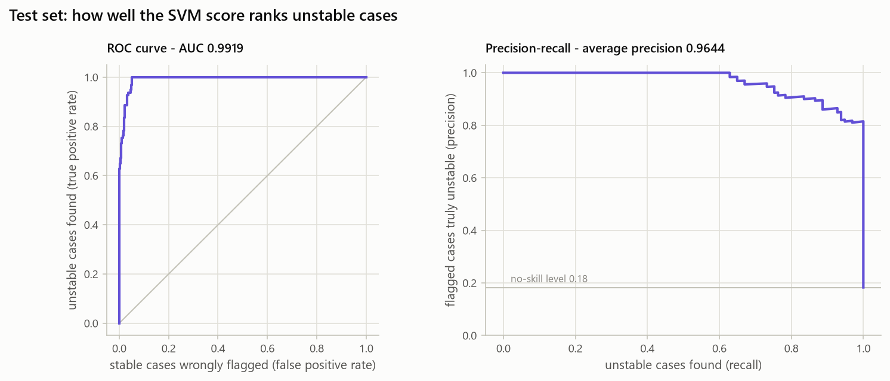
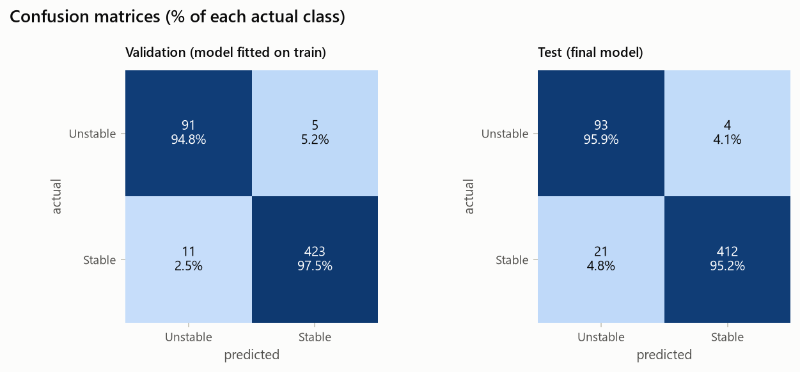
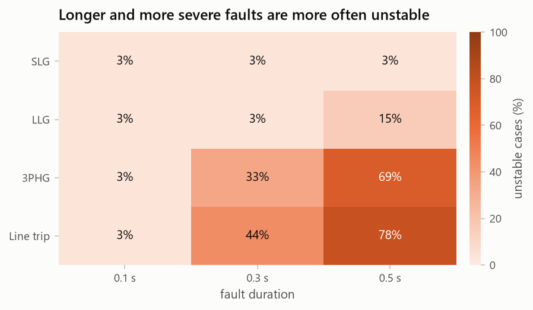
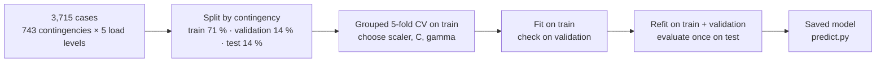
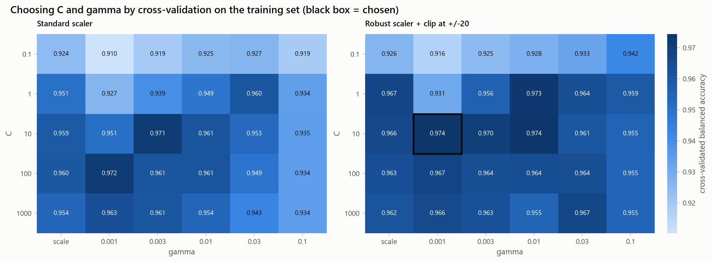
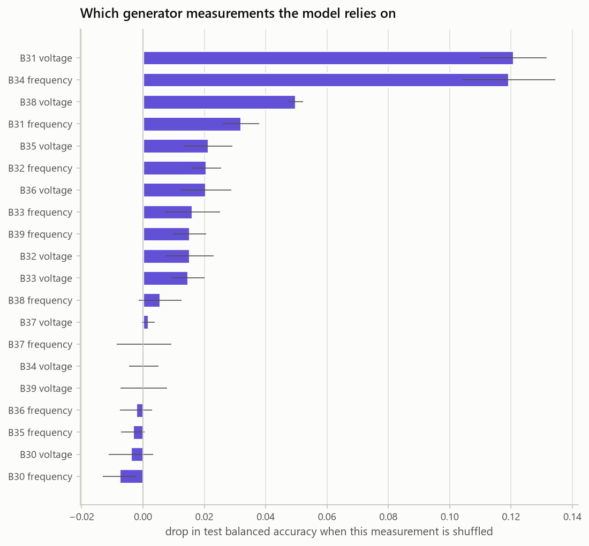

# SVM-based-TSA

**Transient stability assessment of the IEEE 39-bus system with a Support Vector Machine (SVM).**


After a disturbance (a fault, a line trip, a generator trip or a load disconnection), will the power system stay in
synchronism? This project trains an RBF-kernel SVM that answers this from **only four post-disturbance samples of the
voltage and the frequency at each of the ten generator buses**: 80 measurements in total. That makes it a fast
alternative to running a full time-domain simulation for every contingency.

<p align="center">
  
</p>

---

## Contents

- [Results at a glance](#results-at-a-glance)
- [Dataset](#dataset)
- [Method](#method)
- [Quick start](#quick-start)
- [Predicting new cases](#predicting-new-cases)
- [Key findings](#key-findings)
- [Repository structure](#repository-structure)
- [Documents](#documents)
- [Citation](#citation)

---

## Results at a glance

All results are for contingencies that the model **never saw during training**, because the data are split by
contingency (see [Method](#method)).

| | Balanced accuracy | Unstable cases found | Stable cases correct | ROC-AUC |
|---|:---:|:---:|:---:|:---:|
| Grouped 5-fold cross-validation (training set) | **0.974 ± 0.016** | – | – | – |
| Validation set (530 cases) | 0.961 | 91 / 96 (94.8 %) | 423 / 434 (97.5 %) | 0.994 |
| **Test set (530 cases, used once)** | **0.955** | **93 / 97 (95.9 %)** | **412 / 433 (95.2 %)** | **0.992** |

Selected model: robust scaling (median / IQR, clipped at ±20) → RBF-kernel SVM with `C = 10`, `gamma = 0.001`,
`class_weight = "balanced"`.

<p align="center">
  
</p>

---

## Dataset

`IEEE39_voltage_frequency_4sample_SVM_dataset.csv`: **3,715 time-domain simulations** of the IEEE 39-bus (New England)
system. That is **743 contingencies**, each simulated at **5 load levels** (−4, −2, 0, +2, +4 %).

| Contingency type | Contingencies | Cases | Unstable |
|---|---:|---:|---:|
| Generator trip | 10 | 50 | 10.0 % |
| Ground fault + line trip (SLG / LLG / 3PHG, 20 % / 80 % of the line, cleared after 0.1 / 0.3 / 0.5 s) | 612 | 3,060 | 15.0 % |
| Line trip (0.1 / 0.3 / 0.5 s) | 102 | 510 | 41.8 % |
| Load disconnection | 19 | 95 | 0.0 % |
| **Total** | **743** | **3,715** | **18.2 %** |

- **Inputs (80):** for each generator bus B30–B39, 4 voltage-magnitude samples (`Bxx_Vmag_1..4`, p.u.) and
  4 frequency samples (`Bxx_FreqHz_1..4`, Hz).
- **Label:** `Overall_Stability` from the transient stability index (TSI): **1 = stable, 0 = unstable**.
- **Outliers:** 10 rows contain physically impossible readings (up to 13 p.u., 24–81 Hz). In this first experiment
  they are **kept** and placed in the training set.

<p align="center">
  
</p>

---

## Method



1. **Split by contingency.** All five load levels of a contingency go into the same set. A random row split would put
   near-identical cases in both training and test data and overstate the accuracy. The split is stratified, so every set
   has about 18 % unstable cases.
2. **Choose the settings by grouped cross-validation.** 60 combinations (2 scalers × 5 values of `C` × 6 values of
   `gamma`) are scored with 5-fold cross-validation over the training contingencies. A single small validation set
   proved too noisy for this choice.
3. **Check on the validation set**, then **refit on train + validation** and **evaluate once on the test set**.
4. **Analyse** the errors per contingency and the permutation importance of each bus measurement.

<p align="center">
  
</p>

---

## Quick start

```bash
git clone https://github.com/AthukoralaHN/SVM-based-TSA.git
cd SVM-based-TSA
pip install -r requirements.txt        # on Windows: py -m pip install -r requirements.txt

python train_model.py                  # split, tune, evaluate, save model, figures and reports
jupyter notebook transient_stability_svm.ipynb   # or open the notebook in VS Code
```

`train_model.py` reproduces every number in this README, and writes the model to `models/`, 19 figures to `figures/`
and the results to `reports/`.

> The saved model `models/stability_svm.joblib` must be loaded with the scikit-learn version it was trained with
> (1.9.1, pinned in `requirements.txt`).

---

## Predicting new cases

**From the command line.** Pass a CSV with either one row per case (the 80 column names of the dataset) or one
case as a 10-row table:

```text
Bus,V1,V2,V3,V4,F1,F2,F3,F4
B30,0.836,0.847,0.852,0.853,50.238,50.247,50.250,50.249
B31,0.238,0.225,0.219,0.224,51.403,51.568,51.903,52.221
...
B39,...
```

```bash
python predict.py examples/example_case_unstable.csv
```

**From Python:**

```python
from stability_svm.predict import predict_case

# rows: generators B30 ... B39, columns: samples 1 ... 4
vmag = [[...], ...]      # 10 x 4 voltage magnitudes (p.u.)
freq = [[...], ...]      # 10 x 4 frequencies (Hz)

result = predict_case(vmag, freq)
# e.g. for examples/example_case_unstable.csv:
# {'prediction': 'Unstable', 'instability_score': 11.9169, 'outside_training_range': []}
```

The **instability score** is the signed distance from the SVM boundary (> 0 means unstable). **Inputs outside the
training range** are flagged, because the model is least reliable there.

---

## Key findings

- **Fault clearing time dominates.** With 0.1 s clearing only 2.9 % of faults are unstable. At 0.5 s, 68.8 % of
  three-phase faults and 78.2 % of line trips are.
- **Line 16–19 is always unstable:** losing it separates the generators at B33 and B34 from the rest of the network.
- **Higher load means less stability:** 13.9 % unstable at −4 % load, 22.5 % at +4 %.
- **The model relies most on the B31 voltage and the B34 frequency**, which is physically consistent with the data.
- **Main failure mode:** inputs outside the training range. The Bus 38 generator trip drives the B38 frequency below
  every training case and is wrongly flagged as unstable at all five load levels.

<p align="center">
  
</p>

---

## Repository structure

```text
SVM-based-TSA/
├── IEEE39_voltage_frequency_4sample_SVM_dataset.csv   dataset (3,715 cases)
├── transient_stability_svm.ipynb   full analysis with all graphs (start here)
├── train_model.py                  command-line training and evaluation
├── predict.py                      command-line prediction for new cases
├── requirements.txt
├── stability_svm/                  Python package
│   ├── config.py                   paths, feature names, split sizes, tuning grid
│   ├── data.py                     loading, quality checks, contingency-grouped split
│   ├── model.py                    SVM pipeline, cross-validated tuning, save / load
│   ├── evaluate.py                 metrics, breakdowns, permutation importance, learning curve
│   ├── plots.py                    all figures
│   └── predict.py                  predictions for new cases
├── models/stability_svm.joblib     trained model
├── figures/                        19 figures (PNG)
├── reports/                        training report, tuning grids, test predictions
├── examples/                       example input files
├── report/                         full project report (LaTeX + PDF)
└── paper/                          IEEE conference paper (LaTeX + PDF)
```

---

## Documents

| Document | Description |
|---|---|
| [📄 Project report (PDF)](report/transient_stability_svm_report.pdf) | Full 20-page report: dataset, exploratory analysis, method, results, discussion and key code |
| [📄 IEEE conference paper (PDF)](paper/transient_stability_svm_paper.pdf) | 5-page paper in IEEE conference format |
| [📓 Notebook](transient_stability_svm.ipynb) | Every step with graphs and tables |

---

## Citation

If you use this code or dataset, please cite the repository:

```bibtex
@misc{svm_based_tsa,
  author       = {AthukoralaHN},
  title        = {{SVM-based-TSA}: Transient Stability Assessment of the IEEE 39-Bus System Using Support Vector Machines},
  year         = {2026},
  howpublished = {\url{https://github.com/AthukoralaHN/SVM-based-TSA}}
}
```
